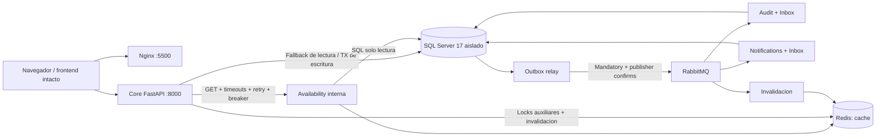

# AE4 - Arquitectura implementada

Estado actualizado 10/11/2026: Macro 2 preservada; Macro 3 implementada y validada. Evidencia ejecutada en AE4_VALIDATION.json. Macro 4 completada; evidencia y diagramas en AE4_EVIDENCE_INDEX.md y AE4_DIAGRAMS.md.

## 1. Topologia real

Ocho dominios logicos: Identity, Hotels, Activities, Availability, Reservations, Payments, Notifications, Audit/Events. Seis procesos backend comparten una imagen; no se afirma que sean ocho microservicios independientes ni que exista database-per-service.

10 contenedores permanentes: frontend, core-api, availability-api, outbox-relay, audit-worker, notifications-worker, availability-worker, SQL, Redis y RabbitMQ. sql-init es tarea unica idempotente que termina en 0, no un servicio healthy. Redes public/backend/messaging/observability; tres ultimas internas. Solo 5500/8000 se publican y solo en 127.0.0.1. No se publica SQL/AMQP/Redis ni metrics de workers.

SQL original Windows TurismoPosadas permanece intacto y con autenticacion integrada. Linux usa SQL Server 17 en volumen propio, base TurismoPosadas_AE4_Integration: misma estructura por scripts/migraciones existentes y copia guardada de diez tablas con IDs/hashes identicos. No se modifico autenticacion global ni se crearon logins en Windows. No hay nuevas migraciones de dominio en Macro 3. La copia reproduce valores/IDs, no es una restauracion bit a bit del catalogo SQL: el original tiene drift de CHECK legacy de hoteles/viajes respecto del script base, ya auditado en Macro 1 y no corregido aqui. Los CHECK que crea el script en la instancia nueva no se agregaron al original.

| Proceso | Responsabilidad y permisos |
|---|---|
| core-api | Identity/Hotels/Activities/Reservations/Payments/Viajes; JWT, roles, propiedad; DML acotado a tablas propias |
| availability-api | Cinco GET de inventario existentes; SELECT en catalogo/reservas y columnas id/activo/rol de usuarios; sin password_hash ni escrituras |
| outbox-relay | SELECT/UPDATE Outbox, AMQP; fuera de TX de negocio |
| audit-worker | Inbox + audit_events en una TX, ACK despues |
| notifications-worker | Inbox + notification_deliveries SIMULADA; no email |
| availability-worker | Invalida Redis; no escribe SQL |

Propiedad logica: usuarios=Identity; hoteles/habitaciones=Hotels; actividades/actividad_turnos=Activities; reservas/request_idempotency/viajes/viaje_hoteles=Reservations; pagos=Payments; outbox_events=unidad de trabajo/relay; inbox_events=por consumidor; audit_events/eventos_procesados=Audit; notification_deliveries=Notifications. Availability deriva datos. schema_migrations es infraestructura; sysdiagrams queda fuera del dominio. zona_id no tiene tabla zonas/FK: no inventar un servicio.

## 2. Inventario completo de endpoints

Todos los routers están en `backend/routes/`. Alias de tablas: **U** usuarios, **H** hoteles, **HA** habitaciones, **AC** actividades, **T** actividad_turnos, **R** reservas, **PA** pagos, **V** viajes, **VH** viaje_hoteles. **L** lectura, **E** escritura.

Dependencias comunes de cada ruta de dominio: `get_db` → Session SQLAlchemy; Pydantic/Path/Query según firma. Toda ruta privada añade `get_current_user` (JWT + consulta U.activo/rol) y `require_roles` si se indica rol. Por eso U figura también en rutas privadas cuyo service opera otra tabla. Health DB usa engine directamente. Se listan además las dependencias específicas por operación.

| Método | Ruta real | Router → función | Dominio / acceso | Operación y tablas | Dependencias específicas |
|---|---|---|---|---|---|
| GET | `/api/v1/actividades/` | `actividad_routes.py` → `list_public` | Activities · Público | Catálogo publicado; L: AC,U | ActividadService.public_list |
| GET | `/api/v1/actividades/gestion` | `actividad_routes.py` → `list_managed` | Activities · PRESTADOR/ADMIN | Actividades propias / todas ADMIN; L: AC,U | ActividadService.managed_query |
| GET | `/api/v1/actividades/gestion/{actividad_id}` | `actividad_routes.py` → `get_managed` | Activities · PRESTADOR/ADMIN | Actividad para gestión; L: AC,U | ActividadService.managed_get |
| GET | `/api/v1/actividades/{actividad_id}` | `actividad_routes.py` → `get_public` | Activities · Público | Actividad publicada; L: AC,U | ActividadService.public_get |
| POST | `/api/v1/actividades/` | `actividad_routes.py` → `create` | Activities · PRESTADOR | Crear propia y PENDIENTE; E: AC; L: U | ActividadService.create |
| PUT | `/api/v1/actividades/{actividad_id}` | `actividad_routes.py` → `update` | Activities · PRESTADOR/ADMIN | Editar y solicitar aprobación si cambia; E: AC; L: U | ActividadService.update |
| PATCH | `/api/v1/actividades/{actividad_id}/estado` | `actividad_routes.py` → `state` | Activities · PRESTADOR/ADMIN | Baja / reactivación; E: AC; L: U | ActividadService.change_state |
| PATCH | `/api/v1/actividades/{actividad_id}/aprobacion` | `actividad_routes.py` → `approval` | Activities · ADMIN | Aprobar / rechazar; E: AC; L: U | ActividadService.approve |
| PATCH | `/api/v1/actividades/{actividad_id}/prestador` | `actividad_routes.py` → `assign` | Activities · ADMIN | Asignar prestador activo; E: AC; L: U | ActividadService.assign_provider |
| GET | `/api/v1/actividades/{actividad_id}/turnos/` | `actividad_routes.py` → `list_turns` | Availability · Público | Turnos futuros con cupos; lista; L: T,AC,U,R | ActividadService.search_turns, cupos_ocupados |
| GET | `/api/v1/actividades/{actividad_id}/turnos/disponibilidad` | `actividad_routes.py` → `search_turns` | Availability · Público | Turnos con cupo suficiente; objeto; L: T,AC,U,R | ActividadService.search_turns(available_only=True) |
| GET | `/api/v1/actividades/{actividad_id}/turnos/gestion` | `actividad_routes.py` → `managed_turns` | Activities · PRESTADOR/ADMIN | Turnos para gestión; L: T,AC,U | ActividadService.managed_turns |
| GET | `/api/v1/actividades/{actividad_id}/turnos/gestion/{turno_id}` | `actividad_routes.py` → `managed_turn` | Activities · PRESTADOR/ADMIN | Turno para gestión; L: T,AC,U | ActividadService.managed_turn |
| GET | `/api/v1/actividades/{actividad_id}/turnos/{turno_id}` | `actividad_routes.py` → `public_turn` | Availability · Público | Cotizar turno público; L: T,AC,U,R | ActividadService.public_turn, cupos_ocupados |
| POST | `/api/v1/actividades/{actividad_id}/turnos/` | `actividad_routes.py` → `create_turn` | Activities · PRESTADOR/ADMIN | Crear turno futuro; fin calculado; E: T; L: AC,U | ActividadService.create_turn |
| PUT | `/api/v1/actividades/{actividad_id}/turnos/{turno_id}` | `actividad_routes.py` → `update_turn` | Activities · PRESTADOR/ADMIN | Editar cupo/horario sujeto a reservas; E: T; L: AC,U,R | ActividadService.update_turn, cupos_ocupados |
| PATCH | `/api/v1/actividades/{actividad_id}/turnos/{turno_id}/estado` | `actividad_routes.py` → `turn_state` | Activities · PRESTADOR/ADMIN | Activar / desactivar turno; E: T; L: AC,U | ActividadService.change_turn_state |
| POST | `/auth/register` | `auth_routes.py` → `register` | Identity · Público | Registrar TURISTA/PRESTADOR; E: U | auth_service.register_user, Argon2id |
| POST | `/auth/login` | `auth_routes.py` → `login` | Identity · Público | Autenticar; rehash condicional; L/E: U | auth_service.authenticate_user, security.create_access_token |
| GET | `/auth/me` | `auth_routes.py` → `me` | Identity · JWT activo (3 roles) | Perfil del JWT vigente; L: U | get_current_user |
| GET | `/api/v1/gestion/reservas` | `gestion_routes.py` → `reservations` | Reservations · PRESTADOR/ADMIN | Reservas recibidas; estado efectivo sin UPDATE; L: R,HA,H,T,AC,U | GestionService.reservas |
| GET | `/api/v1/gestion/reservas/{reserva_id}` | `gestion_routes.py` → `reservation` | Reservations · PRESTADOR/ADMIN | Detalle recibido según propietario actual; L: R,HA,H,T,AC,U | GestionService.reserva |
| GET | `/api/v1/gestion/reservas/{reserva_id}/pagos` | `gestion_routes.py` → `payments` | Payments · ADMIN | Historial de pagos para ADMIN; L: PA,R,U | GestionService.pagos |
| GET | `/api/v1/gestion/publicaciones/hoteles` | `gestion_routes.py` → `hotels` | Hotels · PRESTADOR/ADMIN | Publicaciones paginadas y filtradas; L: H,U | GestionService.publicaciones, HotelService |
| GET | `/api/v1/gestion/publicaciones/actividades` | `gestion_routes.py` → `activities` | Activities · PRESTADOR/ADMIN | Publicaciones paginadas y filtradas; L: AC,U | GestionService.publicaciones, ActividadService |
| GET | `/api/v1/admin/usuarios` | `gestion_routes.py` → `users` | Identity · ADMIN | Usuarios paginados; L: U | UsuariosAdminService.list |
| GET | `/api/v1/admin/usuarios/{usuario_id}` | `gestion_routes.py` → `user` | Identity · ADMIN | Usuario por ID; L: U | UsuariosAdminService.get |
| PATCH | `/api/v1/admin/usuarios/{usuario_id}/estado` | `gestion_routes.py` → `user_state` | Identity · ADMIN | Activar / desactivar; ADMIN protegido con 409; E: U | UsuariosAdminService.change_state |
| GET | `/api/v1/hoteles/{hotel_id}/habitaciones/` | `habitacion_routes.py` → `list_public` | Hotels · Público | Tipos activos del hotel publicado; L: HA,H,U | HabitacionService.public_rooms |
| GET | `/api/v1/hoteles/{hotel_id}/habitaciones/disponibilidad` | `habitacion_routes.py` → `search` | Availability · Público | Disponibilidad agregada; L: HA,H,U,R | HabitacionService.availability, disponibilidad_service |
| GET | `/api/v1/hoteles/{hotel_id}/habitaciones/gestion` | `habitacion_routes.py` → `list_managed` | Hotels · PRESTADOR/ADMIN | Tipos para gestión; L: HA,H,U | HabitacionService.managed_rooms |
| GET | `/api/v1/hoteles/{hotel_id}/habitaciones/gestion/{habitacion_id}` | `habitacion_routes.py` → `get_managed` | Hotels · PRESTADOR/ADMIN | Tipo para gestión; L: HA,H,U | HabitacionService.managed_room |
| GET | `/api/v1/hoteles/{hotel_id}/habitaciones/{habitacion_id}/disponibilidad` | `habitacion_routes.py` → `check` | Availability · Público | Cotización de un tipo, incluido disponible=false; L: HA,H,U,R | HabitacionService.availability, disponibilidad_service |
| GET | `/api/v1/hoteles/{hotel_id}/habitaciones/{habitacion_id}` | `habitacion_routes.py` → `get_public` | Hotels · Público | Tipo publicado; L: HA,H,U | HabitacionService.public_room |
| POST | `/api/v1/hoteles/{hotel_id}/habitaciones/` | `habitacion_routes.py` → `create` | Hotels · PRESTADOR/ADMIN | Crear tipo de habitación; E: HA; L: H,U | HabitacionService.create |
| PUT | `/api/v1/hoteles/{hotel_id}/habitaciones/{habitacion_id}` | `habitacion_routes.py` → `update` | Hotels · PRESTADOR/ADMIN | Editar; impedir reducción incompatible con reservas; E: HA; L: H,U,R | HabitacionService.update, disponibilidad_service |
| PATCH | `/api/v1/hoteles/{hotel_id}/habitaciones/{habitacion_id}/estado` | `habitacion_routes.py` → `change_state` | Hotels · PRESTADOR/ADMIN | Activar / desactivar tipo; E: HA; L: H,U | HabitacionService.change_state |
| GET | `/api/v1/hoteles/` | `hotel_routes.py` → `listar_hoteles` | Hotels · Público | Catálogo publicado; L: H,U | HotelService.get_all |
| GET | `/api/v1/hoteles/gestion` | `hotel_routes.py` → `listar_gestion` | Hotels · PRESTADOR/ADMIN | Hoteles del propietario / todos ADMIN; L: H,U | HotelService.management_query |
| GET | `/api/v1/hoteles/gestion/{id}` | `hotel_routes.py` → `obtener_gestion` | Hotels · PRESTADOR/ADMIN | Detalle para gestión; L: H,U | HotelService.get_managed |
| GET | `/api/v1/hoteles/{id}` | `hotel_routes.py` → `obtener_hotel` | Hotels · Público | Hotel publicado; L: H,U | HotelService.get_by_id |
| POST | `/api/v1/hoteles/` | `hotel_routes.py` → `crear_hotel` | Hotels · PRESTADOR | Crear propio y PENDIENTE; E: H; L: U | HotelService.create |
| PUT | `/api/v1/hoteles/{id}` | `hotel_routes.py` → `actualizar_hotel` | Hotels · PRESTADOR/ADMIN | Editar y solicitar nueva aprobación si cambia; E: H; L: U | HotelService.update |
| PATCH | `/api/v1/hoteles/{id}/estado` | `hotel_routes.py` → `cambiar_estado_hotel` | Hotels · PRESTADOR/ADMIN | Baja / reactivación; emitir evento de baja; E: H; L: U | HotelService.cambiar_estado, RabbitMQ |
| PATCH | `/api/v1/hoteles/{id}/aprobacion` | `hotel_routes.py` → `aprobar_hotel` | Hotels · ADMIN | Aprobar / rechazar publicación; E: H; L: U | HotelService.approve |
| PATCH | `/api/v1/hoteles/{id}/prestador` | `hotel_routes.py` → `asignar_prestador` | Hotels · ADMIN | Asignar prestador activo; vuelve a PENDIENTE si cambia; E: H; L: U | HotelService.assign_provider |
| POST | `/api/v1/reservas/{reserva_id}/pagos/simular` | `pago_routes.py` → `simulate` | Payments · TURISTA | Intento de pago y confirmación atómicos; replay; E: PA,R; L: HA,H,T,AC,U | PagoService.simulate, ReservaService.lock_owned |
| GET | `/api/v1/reservas/{reserva_id}/pagos` | `pago_routes.py` → `list_own` | Payments · TURISTA | Pagos de reserva propia; L: PA,R,U | PagoService.list_own |
| POST | `/api/v1/reservas/hotel` | `reserva_routes.py` → `create_hotel` | Reservations · TURISTA | Retener habitaciones y cotizar con precio de servidor; E: R; L: HA,H,U | ReservaService.create_hotel, disponibilidad_service, HotelService |
| POST | `/api/v1/reservas/actividad` | `reserva_routes.py` → `create_activity` | Reservations · TURISTA | Retener plazas y cotizar con precio de servidor; E: R; L: T,AC,U | ReservaService.create_activity, ActividadService |
| GET | `/api/v1/reservas/` | `reserva_routes.py` → `list_own` | Reservations · TURISTA | Reservas propias; persiste expiración propia; L/E: R; L: HA,H,T,AC,U | ReservaService.list/expire |
| GET | `/api/v1/reservas/{reserva_id}` | `reserva_routes.py` → `get_own` | Reservations · TURISTA | Reserva propia; persiste expiración propia; L/E: R; L: HA,H,T,AC,U | ReservaService.get/expire |
| PATCH | `/api/v1/reservas/{reserva_id}/cancelar` | `reserva_routes.py` → `cancel_own` | Reservations · TURISTA | Cancelar propia o persistir EXPIRADA; E: R; L: HA,H,T,AC,U | ReservaService.cancel/lock_owned |
| GET | `/api/v2/viajes/` | `viaje_routes.py` → `listar_viajes` | Reservations/compatibilidad · Público | Planes AE2; no son reservas; L: V | ViajeService.get_all |
| GET | `/api/v2/viajes/{id}` | `viaje_routes.py` → `obtener_viaje` | Reservations/compatibilidad · Público | Plan AE2 por ID; L: V | ViajeService.get_by_id |
| POST | `/api/v2/viajes/` | `viaje_routes.py` → `crear_viaje` | Reservations/compatibilidad · ADMIN | Crear planificación; E: V; L: U | ViajeService.create |
| POST | `/api/v2/viajes/{id}/hoteles` | `viaje_routes.py` → `agregar_hotel_a_viaje` | Reservations/compatibilidad · ADMIN | Asociar estadía planificada sin consumir stock; E: VH; L: V,H,U | ViajeService.add_hotel, HotelService |
| GET | `/api/v2/viajes/{id}/hoteles` | `viaje_routes.py` → `listar_hoteles_de_viaje` | Reservations/compatibilidad · Público | Estadías activas del plan; L: V,VH | ViajeService.get_hoteles |
| GET | `/health` | `main.py` → `health` | Entorno · Público | Estado de proceso; sin tablas | Ninguna |
| GET | `/health/db` | `main.py` → `database_health` | Entorno · Público | SELECT 1; sin tablas de dominio | engine SQL Server |
| GET | `/ready` | `main.py` -> `ready` | Entorno publico | SELECT 1/schema_migrations, Redis PING y AMQP; sin dominio | services.readiness |
| GET | `/metrics` | `main.py` -> `metrics` | Operacional privado, bearer separado | Prometheus por proceso; sin SQL; excluido de OpenAPI | metrics_response |

**Reglas de acceso adicionales:** PRESTADOR opera solo recursos propios y solo desactiva hoteles/actividades; reactivarlos requiere ADMIN. Alta de hotel/actividad exige PRESTADOR, no ADMIN. TURISTA opera reservas/pagos propios. ADMIN no puede cambiar estado de cuentas ADMIN. Gestión de pagos recibidos es solo ADMIN. Hijos siempre se verifican contra su hotel/actividad.

**Rutas de framework fuera de OpenAPI:** `/openapi.json`, `/docs`, `/docs/oauth2-redirect`, `/redoc`: GET/HEAD públicos, sin tablas, generados por FastAPI/Starlette. OPTIONS de preflight lo resuelve CORS, no un router de dominio. No hay DELETE de negocio. GET `/ready` esta implementado en main.py (publico, SELECT 1/schema_migrations + Redis/AMQP); GET `/metrics` es privado por bearer operacional y se excluye de OpenAPI.

**HTTP vigente:** GET/PUT/PATCH exitosos 200; altas 201; login 200; pago nuevo 201/replay 200. Ausencia de disponibilidad devuelve 200 con lista vacía o `disponible=false`. 400 validación, 401 JWT, 403 rol, 404 inexistente/no publicado/ajeno y 409 regla de negocio no son equivalentes a fallos internos. Swagger normaliza 422 a 400. Macro 4 documenta los 404/409 reales de Viajes, 413 de cuerpos excesivos, 429 de cuotas y 503 operacionales; no cambia DTOs ni comportamiento.

## 4. Contratos frontend/backend que hay que preservar

| Flujo | Contrato efectivo | Adaptación/evidencia frontend |
|---|---|---|
| Login | POST /auth/login → access_token/token_type/expires_in; GET /auth/me → usuario | usuarios.service.js hace ambas llamadas antes de guardar sesión; rol viene de /me |
| Registro | nombre, email, password (12–128), rol TURISTA/PRESTADOR opcional; devuelve usuario, no JWT | Formulario público registra TURISTA y luego hace login; no enviar apellido/teléfono al schema extra=forbid |
| Hotel / inventario | HotelResponse público sin prestador/aprobación; gestión añade esos campos | hoteles.service.js y servicios gestion/admin usan rutas diferentes |
| Disponibilidad hotel | fecha_desde, fecha_hasta, personas, cantidad_habitaciones; objeto con habitaciones[] | habitaciones.service.js traduce checkin/checkout y adultos+niños |
| Actividades / turnos | duración en minutos, precio_persona; turnos[] o lista según ruta; cupos_disponibles e inicio/fin UTC | actividades.service.js y turnos.service.js adaptan nombres y hora Argentina |
| Reserva HOTEL | hotel_id, habitacion_id, fecha_desde, fecha_hasta, personas, cantidad_habitaciones | reservas.service.js; no enviar total/turista/estado/precio |
| Reserva ACTIVIDAD | actividad_id, turno_id, personas | Mismo service; servidor toma tarifa vigente y cupo |
| Pago | body {clave_idempotencia:UUID, resultado}; response {pago,reserva} | pagos.service.js traduce importe/estado; método de pago queda solo en interfaz |
| Listas privadas | {items,total,offset,limit}, limit ≤100 | gestion.service.js/usuarios.service.js normalizan; algunas vistas consumen solo primera página |
| Confirmación/cancelación | Pago aprobado confirma; cancelar por PATCH, preservando historia | No existe POST confirmar separado; frontend real recupera reserva |
| Ofertas / recuperación | No implementados en API | Servicios bloquean uso real; constantes antiguas no prueban existencia de endpoint |

`ENDPOINTS.habitaciones=/api/v1/habitaciones/` y `pagos=/api/v1/pagos/` son constantes heredadas sin consumidor activo detectado; las llamadas reales usan rutas anidadas. La rama de ofertas a API queda detrás de NOT_IMPLEMENTED. No crear esos endpoints para satisfacer tests antiguos.

**Brecha de escala:** HotelBase admite calificación 0–10; normalizarCalificacion frontend admite 0–5. Con datos actuales en cero no rompe la demo, pero valores futuros >5 se descartan visualmente. Definir escala contractual antes de ampliar dataset, sin convertirla silenciosamente en esta fase.

Eventos v1 implementados: AE4_EVENTS.md. REST conserva /auth, /api/v1 y /api/v2; no cambiaron contratos de dominio. Header Idempotency-Key opcional en altas HOTEL/ACTIVIDAD; replay 201 y payload incompatible 409.

## 5. Comunicacion implementada

- Core->Availability: unicamente GET, mismos paths/DTO publicos del core. URL configurable; vacia conserva ejecucion nativa en un proceso. Reserva/pago nunca usan una respuesta remota para decidir stock: recalculan en TX SQL con locks existentes.
- HTTPX: connect .3 s, read 1 s, write .5 s, pool .2 s; presupuesto entre intentos 1.5 s, cuerpo <=256 KiB. Maximo 1 retry GET con backoff 25 ms si queda presupuesto. No retries de comandos POST ni de errores 4xx/contratos invalidos. 400/404 de negocio se propagan; fallo remoto usa calculo SQL local real, no stock inventado.
- Breaker por proceso: CLOSED, 5 operaciones fallidas -> OPEN 10 s; una prueba HALF_OPEN; exito -> CLOSED, fallo -> OPEN. Evita nuevas llamadas mientras abre; no sustituye disponibilidad SQL ni locks. Estado exportado en metrica privada.
- Redis: cache hotelera (actividades consultan SQL), TTL 10 s configurable y menor por proximo vencimiento pendiente solapado. Clave incluye hash de base, hotel, generacion y hash de todos los parametros/room_id. Elegibilidad publica se comprueba en SQL. HIT/MISS/fallback en logs y counters.
- Invalidacion tras commit por generacion; Outbox/consumidor como respaldo. Nada de FLUSHALL. Fallback SQL si cache/lock cae. Lock habitacion/turno: UUID, PX 5000 ms, espera 150 ms y Lua de liberacion por propietario; SQL sigue siendo autoridad aunque caduque lease.
- RabbitMQ: envelope v1 y traceparent opcional; Outbox atomo con negocio, lease SQL, secuencia por agregado, mensaje persistente, mandatory/confirm antes de PUBLISHED. Relay retry limitado; consumidores Inbox/efecto atomicos, retry/DLQ existentes sin duplicar mecanismos. Ver AE4_EVENTS.md.

## 6. Consistencia y operacion

Pagos+confirmacion comparten TX; cancelacion conserva pagos historicos. PENDIENTE_PAGO vencida no bloquea stock aunque aun no se persista EXPIRADA. GET propio de reservas puede escribir expiracion: no cachearlo ni incluirlo en Availability read-only. Idempotencia de alta durable por actor/operacion/hash de clave y payload; sin header se conserva el contrato previo. Pago mantiene UUID global UNIQUE, un aprobado por reserva, nuevo 201/replay 200.

SQL conserva UPDLOCK/HOLDLOCK y orden publicacion->inventario->reserva. Query timeout 5 s, lock 2 s, pool 2 s nativo/1 s Compose, conexion 5 s nativo/2 s Compose. Pool/operacion SQL no disponible devuelve 503 controlado; no retry ciego de TX ni commit incierto. AMQP socket 2 s, stack 5 s, blocked 3 s, heartbeat 30 s configurables; la deteccion de enlace silencioso usa heartbeat, no se promete un deadline global de confirm de 3 s.

/health no hace IO. /ready: SQL/migraciones criticos (503), Redis/AMQP degradables (200 degraded); Availability no requiere AMQP. Probes de workers: heartbeat de progreso, PID y SQL/AMQP (Redis ademas para invalidacion). Healthcheck no escribe dominio. Compose restart/depends_on no acredita HA ni reemplaza reconexion.

Secrets externos por *_FILE/env, imagenes base por digest, dependencias fijadas, ODBC18 Linux, usuario no root, sistema de archivos read-only/tmpfs en apps y frontend. JWT solo en core; credenciales SQL por proceso. Seguridad y limites: AE4_SECURITY.md. Logs, metricas y trazas: AE4_OBSERVABILITY.md. Reproduccion: AE4_CONTEXT.md.

## 7. Limites pendientes

Viajes AE2 mantiene pendiente la carrera de estadias solapadas del mismo viaje identificada en Macro 1; es planificacion, no inventario reservado, y no forma parte de las garantias de ultima habitacion/cupo. Reproducir y decidir correccion en Macro 4.

No HA/failover multi-host, TLS publico/certificados de despliegue, email/pago externo, collector cloud, Grafana, CI/CD, registry ni deployment remoto. Macro 4 resolvió los 28 fallos históricos frontend y midió carga/P95, caché, estrés y resiliencia: ver AE4_EVIDENCE_INDEX.md. No acredita HA ni capacidad productiva. La demo actual no certifica una rubrica de ocho servicios desplegables: el usuario indico que no esta especificado.

## Validación Macro 4

La topología y propiedad de datos anteriores no se rediseñaron. Disponibilidad MISS/HIT tiene comparación medida (media/P95/throughput); se documentan 503 de contención y el límite de saturación a 75 VUs. Recorridos reales de los tres roles, dos flujos Chromium completos, seguridad, SQL desechable, entrega idempotente y fallos de dependencias aprobados. Diagramas reproducibles: AE4_DIAGRAMS.md. No se crearon endpoints/modelos/migraciones de dominio en esta fase.
