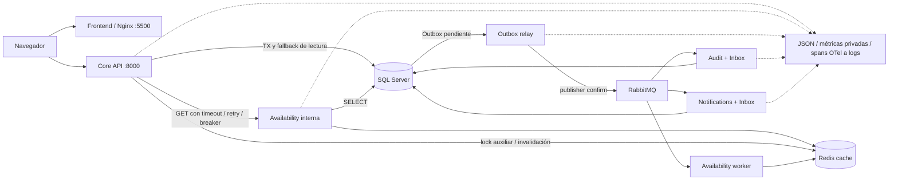
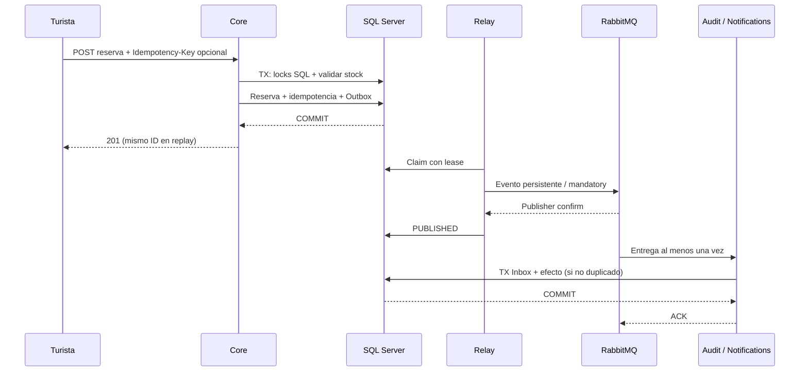
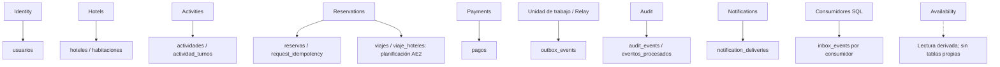
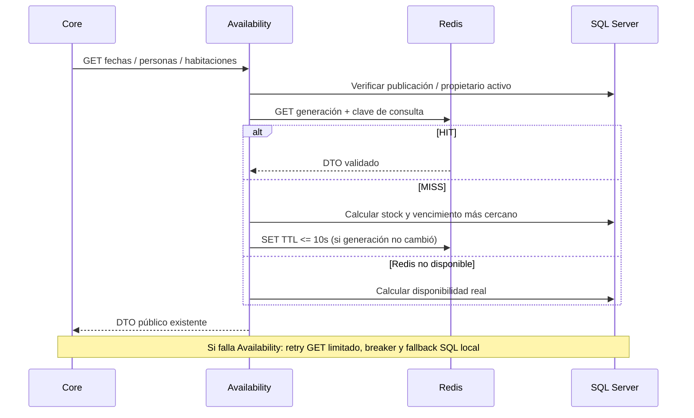

# AE4 — diagramas reproducibles

Fuente: módulos y Compose reales. Ocho dominios lógicos; seis procesos Python comparten imagen y SQL. No se afirma database-per-service ni alta disponibilidad.

## Arquitectura

## Reserva y entrega

Notifications solo consume confirmada/cancelada. Availability invalida sin Inbox SQL; repetir invalidación es inocuo. Una caída tras confirm puede repetir mensaje, no perderlo. Reserva/pago nunca confían en caché para decidir stock.

## Propiedad lógica de datos

## Disponibilidad

